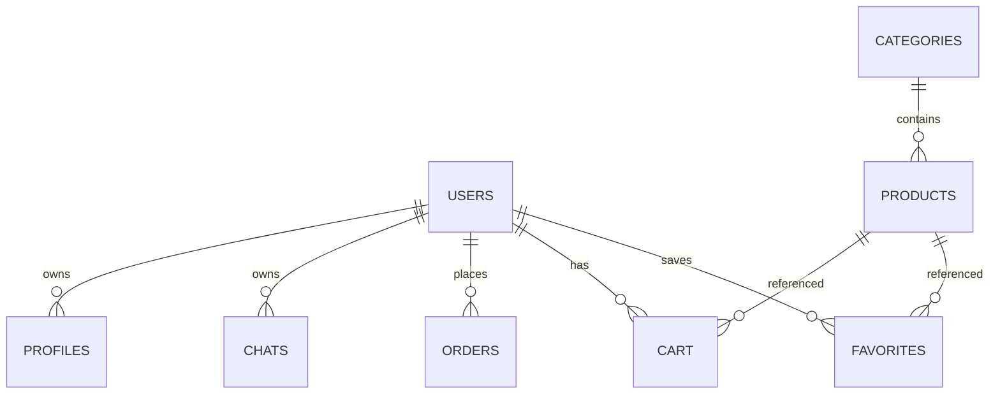

# 需求与设计基线

## 产品范围

角色：访客、注册用户、管理员。一个 Web 系统，商城与独立聊天两种入口，用户数据按账号归属。商品事实由商品资料库提供；外部搜索为后续任务，不展示虚假搜索结果。

## 用户故事及验收

| 故事 | 验收 |
|---|---|
| 访客浏览商品 | 搜索、分类、排序、分页不要求登录，只展示上架商品 |
| 用户保存候选 | 需登录；另一个账号看不到其收藏 |
| 替亲友选购 | 独立偏好档案；不能读取/修改其他用户档案 |
| 从商品进入对话 | 传入商品 ID，推荐来自资料库；切换对象新建对话 |
| 明确排除成分 | 确认含有的排除；资料不足单独计数，不推断安全 |
| 提交模拟订单 | 原子校验与扣库存，历史价格不随商品更新而变化 |
| 取消订单 | 只能取消自己的未取消订单，库存最多恢复一次 |
| 管理员维护商品 | 普通用户接口返回403，下架后商城不可访问 |

## 实体关系

订单明细目前保存为 JSON 快照；商品规格为 JSON，配料允许 NULL。金额统一使用整数分，公开上架商品限定人民币。导入的外币商品先保持下架。

## 信任边界

客户端不提交用户归属 ID，服务端依据会话查询 user_id；管理员角色只能本地命令建立。所有 SQL 值参数化。模型只解释服务端筛选后的候选，不获得数据库修改权限。UI 展示动态文字先转义。

规则模式只支持明确预算句式、部分商品关键词和排除表达，不是通用语义检索。当前支持移除预算和指定排除条件，包括本轮应用的长期偏好；移除只影响当前对话。比较中的商品ID会在后续对话中保留，输入“重新找商品”可退出原候选范围。

## 演示流程

1. 初始化教学数据，创建管理员。
2. 注册用户 A，创建“妈妈”档案，设置排除滑石粉。
3. 搜索商品，收藏，勾选两件进入 AI 对比。
4. 对话“推荐100元以内的VC，不要滑石粉”：教学数据中仅符合条件的VC出现，未知配料提示排除。
5. 加购、修改数量、模拟下单，查看订单；取消后库存恢复。
6. 管理员修改商品价格/下架；历史订单保留原价。
7. 切换用户 B，确认不能看到 A 的记录。

## 毕设后续必须补齐

- 导师确认范围与创新点，明确个人贡献。
- 接入原 React Chat 或完善当前 Chat；真实模型凭证下的端到端验证。
- 六类600条历史商品已采样导入，仍需核验实际购买来源、人民币价格及配料；默认24件是虚构教学数据。
- SKU/店铺报价拆分；相同商品不同规格不混价；来源ID去重及人工核验报价快照已实现。
- 基础用户启停、分类编辑、后台分页与搜索、反馈闭环已实现；仍需完善实际运营规则及更大规模数据性能。
- 密码重置、细粒度审计、会话管理与注册滥用防护。
- 对话并发版本控制，过长对话压缩和导出（会话删除已实现）。
- 浏览器外部搜索适配、任务进度、失败恢复、报价快照和人工审核。
- 实验集与基线：硬约束违反率、未知处理、多轮保留、响应耗时与成本；不得编造实验结果。
- 公网部署、移动端与无障碍检查、备份恢复、完整论文与答辩材料。
